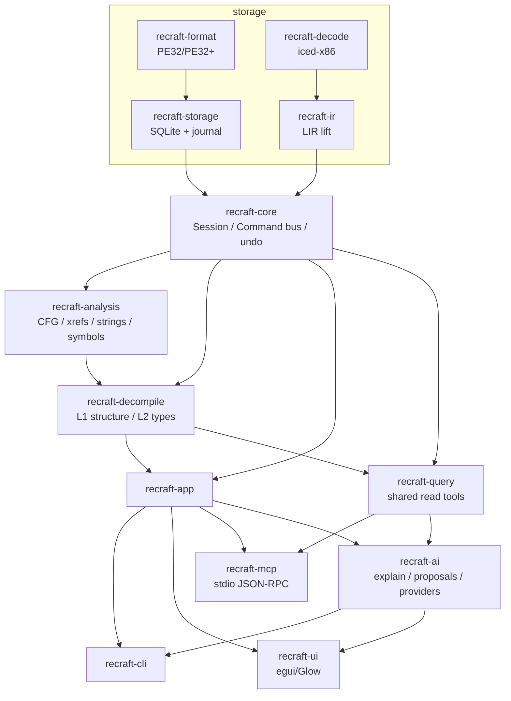

# ReCraft

[简体中文](README.md) | **English**

> **Status: M3 complete; M4 features and artifacts are complete. The public preview
> awaits code signing and a clean-VM re-check.** Import/analyze PE32/PE32+
> (x64 + Win32), structured pseudo-C with signatures/ABI/types, rename/comment/prototype/
> struct-type writes through a journaled command bus with undo, an MCP server (read-only
> by default, `--write` enables the write tools), and provider-backed AI (explain / rename
> proposals / triage) with a propose-apply UI.
> Quality gates: corpus semantic coverage **97.4%**, structured rate **100%**; notepad
> **99.6%** coverage and **97.6%** structured (494/506); crackme **92.9%** (460/495),
> Go **91.9%** (2,998/3,261); 1 GiB
> sample: import ~4 s, analyze ~0.3 s, peak 5.6 MiB (debug). See
> [`docs/M4.md`](docs/M4.md) for the preview checklist and [`docs/FAQ.md`](docs/FAQ.md).

ReCraft is an AI-native reverse-engineering platform: a native desktop disassembler and
decompiler for Windows binaries, with an MCP server and LLM assistance built in from day one.

It is an independent, clean-room implementation. It is **not** affiliated with Hex-Rays or
IDA Pro, and does not use IDA's SDK, database format, or signature libraries.

## Why ReCraft

- **Native, not Electron**: Rust + egui desktop app; no webview, no Python runtime.
- **Decompiler in the open**: LIR → SSA-lite → structured pseudo-C; every token maps back
  to an instruction address; golden snapshots guard every change.
- **AI that proposes, never silently writes**: proposals carry evidence addresses and a
  confidence; writes go through the same journaled command bus as manual edits (undoable).
- **Provider optional**: AI heuristics run offline; a configured LLM provider adds
  model-backed explain/rename/polish, with prompts redacted + budgeted and results cached
  and audited locally.
- **MCP-native**: OpenCode and other agents can query functions, pseudocode, xrefs,
  strings, imports and call graphs through an MCP server; `--write` also renames, comments
  and sets prototypes, each step undoable.
- **Built for triage**: API behaviour tagging, strings/xrefs, runtime symbol recovery
  (Go/Rust/C++), one-command triage with suspicious-function ranking.
- **Honest engineering**: documented limitations, measured quality gates, reproducible
  corpus (MSVC, no CRT, linker map as ground truth).

| | ReCraft | IDA Pro | Ghidra |
|---|---|---|---|
| Price / license | AGPL-3.0-only | commercial | Apache-2.0 |
| UI | native Rust/egui | native | Java/Swing |
| Decompiler | self-built (readable, not compilable) | Hex-Rays (mature) | mature |
| MCP / AI assist | built in (provider-backed) | plugins/add-ons | plugins |
| 1 GiB sample gate | ✅ automated | ✅ | ✅ |
| IDA plugin ecosystem | ❌ | ✅ | ❌ |

## Documents

[`docs/README.md`](docs/README.md) indexes all design/milestone docs; start with
[`docs/DESIGN.md`](docs/DESIGN.md), then [`docs/FAQ.md`](docs/FAQ.md) and
[`docs/ROADMAP.md`](docs/ROADMAP.md). The icon concept and usage rules are documented in
[`docs/ICON.md`](docs/ICON.md).

## Goals (v1)

- **PE x64 + Win32 x86** static analysis. ELF / ARM64 / firmware later.
- **Self-built decompiler** (LIR → SSA → structured C-like pseudocode). Readable output,
  not guaranteed compilable — every token maps back to its instruction address.
- **Scales to 1 GB samples**, stays interactive (paged storage, background analysis).
- **Malware-triage first**: strings, imports, cross-references, API behaviour tagging,
  "find `main`", "follow the network callback".
- **MCP-native AI**: function explanation, naming proposals, sample summaries,
  natural-language queries over the database. AI can only *propose* changes; a human applies them.
- **Native egui UI**, dense IDA-like layout, modern look, English + 简体中文
  (Fluent `.ftl` resources under `crates/recraft-ui/locales/`).

## Architecture

Headless core + command bus + MCP server + native UI client. See
[`docs/DESIGN.md`](docs/DESIGN.md) for the full design.



All writes (rename/comment/prototype/apply_type) go through `recraft-core`'s journaled
command bus; analysis output lives in derived tables and can be rebuilt at any time. The
`recraft-app` node in the diagram is the planned orchestration layer (currently a skeleton);
the CLI and UI use `recraft-core`, `recraft-analysis` and `recraft-decompile` directly.

## Building

Requires Rust **1.85+** (stable). No other toolchain is needed on Windows.

```powershell
cargo build --workspace
cargo test --workspace
```

Run the desktop app against a project (or drag a PE file onto its window):

```powershell
cargo run -p recraft-ui -- path\to\sample.rcraft
```

The build produces `target\debug\recraft.exe` (desktop GUI) and
`target\debug\recraft-cli.exe` (command line; the cargo package names stay
`recraft-ui` / `recraft-cli`).

First import a binary from the command line (read-only commands such as `strings`,
`funcs`, `decompile`, `search` or `callgraph` also accept a PE path directly and
auto-analyze it into a temporary project):

```powershell
cargo run -p recraft-cli -- analyze C:\Windows\System32\notepad.exe --out notepad.rcraft
cargo run -p recraft-cli -- import C:\Windows\System32\notepad.exe -o notepad.rcraft
cargo run -p recraft-cli -- disasm notepad.rcraft --count 40
cargo run -p recraft-cli -- decompile notepad.rcraft --addr entry
cargo run -p recraft-cli -- decompile notepad.rcraft --addr entry --structured
cargo run -p recraft-cli -- decompile notepad.rcraft --addr entry --l2
cargo run -p recraft-cli -- analyze notepad.rcraft
cargo run -p recraft-cli -- strings notepad.rcraft
cargo run -p recraft-cli -- xrefs notepad.rcraft --addr entry
cargo run -p recraft-cli -- imports notepad.rcraft
cargo run -p recraft-cli -- search notepad.rcraft --bytes "4d5a" --limit 5
cargo run -p recraft-cli -- search notepad.rcraft --string "This program"
cargo run -p recraft-cli -- callgraph notepad.rcraft --json
cargo run -p recraft-cli -- batch notepad.rcraft --script batch.json --dry-run
cargo run -p recraft-cli -- eval C:\Windows\System32\kernel32.dll
cargo run -p recraft-cli -- metrics notepad.rcraft --list
cargo run -p recraft-cli -- lint notepad.rcraft --level l1
cargo run -p recraft-cli -- golden notepad.rcraft --dir golden-out --check
cargo run -p recraft-cli -- export-pseudo notepad.rcraft --dir pseudo-out --only-unstructured
```

The analysis corpus is built with MSVC (no CRT) and doubles as a regression benchmark
where exports + `.pdata` are ground truth:

```powershell
.\corpus\build.ps1
cargo run -p recraft-cli -- eval .\corpus\build\x64\corpus.exe
# Linker map: ground truth for every function, including non-exported helpers.
cargo run -p recraft-cli -- eval .\corpus\build\x64\corpus.exe --map .\corpus\build\x64\corpus.map
```

A Go sample validates runtime symbol recovery (kept `pclntab`):

```powershell
.\corpus\build-go.ps1
cargo run -p recraft-cli -- import .\corpus\build\go\corpus-go.exe -o go.rcraft
cargo run -p recraft-cli -- analyze go.rcraft
cargo run -p recraft-cli -- funcs go.rcraft    # main.main, runtime.*, ...
```

A C++ sample validates symbol demangling:

```powershell
.\corpus\build-cpp.ps1
cargo run -p recraft-cli -- import .\corpus\build\cpp\corpus-cpp.dll -o cpp.rcraft
cargo run -p recraft-cli -- analyze cpp.rcraft
cargo run -p recraft-cli -- funcs cpp.rcraft   # recraft::DemoTarget::get(void) const, ...
cargo run -p recraft-cli -- demangle "?overloaded@recraft@@YAHH@Z"
```

The real-world CTF crackme lives in `corpus\real\crackme\` as source plus a build script:
`build.ps1` reproduces the case binary (same SHA-256 as `docs\cases\crackme_win_x64.md`) with
MSVC. Binaries, maps and `.rcraft` projects stay build products and are never committed.

### Packaging

```powershell
pwsh -File scripts/package.ps1 -NoMsi         # release build + green zip + SHA256SUMS
# dist/recraft-v0.1.0-windows-x64.zip, dist/ReCraft-0.1.0/, dist/SHA256SUMS.txt
pwsh -File scripts/package.ps1                # also builds the MSI when the WiX toolchain is there
# dist/recraft-v0.1.0-windows-x64.msi (WiX v5, per-machine to %ProgramFiles%\ReCraft, one UAC prompt)
pwsh -File scripts/verify-msi.ps1             # MSI: structure + payload + install/uninstall (elevated)
```

The MSI uses the WiX 5.0.2 tool pinned in `.config/dotnet-tools.json` (`dotnet tool
restore`); machines without dotnet/WiX pass `-NoMsi` and get the zip only. See
[`docs/RELEASE.md`](docs/RELEASE.md) for the release checklist; CI uploads the zip
(package job), the MSI (msi job) and checksums as artifacts.

### Installing (unsigned preview builds)

v0.1 preview binaries are **not code-signed** (a deliberate decision; see
[`docs/RELEASE.md`](docs/RELEASE.md)). Windows SmartScreen will show "Unknown publisher"
until the project adopts a trusted OSS signing service:

1. Download `recraft-v0.1.0-windows-x64.zip` or `recraft-v0.1.0-windows-x64.msi` together
   with `SHA256SUMS.txt`.
2. Verify the download before running:
   ```powershell
   Get-FileHash .\recraft-v0.1.0-windows-x64.msi -Algorithm SHA256
   # compare with the matching line in SHA256SUMS.txt
   ```
3. If SmartScreen appears: **More info → Run anyway**. The MSI installs per-machine into
   `%ProgramFiles%\ReCraft` and asks for administrator permission once; unzip the portable
   zip instead if you would rather not install anything.

Signed builds (and the exact certificate identity) will be announced when available;
until then checksums are the integrity reference.

### Demo

```powershell
pwsh -File scripts/demo.ps1 -Keep     # 9-step CLI walkthrough, then open the GUI
```

The full 10-minute script (CLI + GUI + MCP client + local LLM) is in
[`docs/DEMO.md`](docs/DEMO.md).

The UI binary renders with OpenGL (Glow); wgpu/DX12 crashed on an Intel UHD driver
during the spike, see [`docs/adr/ADR-002-ui-framework.md`](docs/adr/ADR-002-ui-framework.md).

### MCP server

Model Context Protocol tools over stdio (read-only by default; `--write` adds the
journaled write tools): `list_functions`, `get_disassembly`, `get_pseudocode` (L0/L1/L2),
`xrefs_to/from`, `list_strings`, `list_imports`, `list_exports`, `get_metadata`,
`callgraph`, `search_bytes`, `function_summary`, `find_api_callers`, plus project
resources; `--write` adds `rename`/`set_comment`/`set_prototype`/`apply_type`/
`define_function`/`define_struct`/`batch`/`undo`.

```powershell
cargo run -p recraft-cli -- serve-mcp notepad.rcraft
# newline-delimited JSON-RPC 2.0 on stdin/stdout; see docs/MCP.md
```

### AI assist

The CLI builds explanations and rename proposals offline by default and only sends the
redacted prompt with `--llm`; sample triage is always offline. Proposals carry evidence
addresses and are only applied through the journaled command bus. After the GUI's **AI**
sidebar configures a provider (endpoint/model/API-key, persisted to
`%LOCALAPPDATA%\ReCraft\ai-settings.json`), **Explain**, **Suggest names** and **Polish** all
call the model:

```powershell
cargo run -p recraft-cli -- ai explain notepad.rcraft --addr entry
cargo run -p recraft-cli -- ai explain notepad.rcraft --addr entry --llm
cargo run -p recraft-cli -- ai suggest notepad.rcraft --out proposals.json
cargo run -p recraft-cli -- ai suggest notepad.rcraft --out proposals.json --llm
cargo run -p recraft-cli -- ai triage notepad.rcraft
cargo run -p recraft-cli -- ai apply notepad.rcraft proposals.json --yes   # undoable
```

## Contributing

Contributions are welcome. Everything is accepted under **AGPL-3.0-only** (inbound =
outbound): certify the [DCO](https://developercertificate.org/) with `git commit -s` —
there is no CLA and no copyright assignment.

See [`CONTRIBUTING.md`](CONTRIBUTING.md).

Never commit malware samples or binaries — use local, uncommitted test data only.

## License

- **AGPL-3.0-only** (see [`LICENSE`](LICENSE)): distributing the binaries, or exposing them
  over a network, requires offering the corresponding source. The project does not sell a
  commercial license.
- The "ReCraft" name and logo are governed by [`TRADEMARK.md`](TRADEMARK.md).
