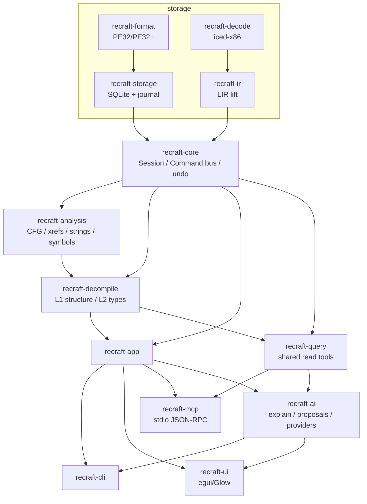

# ReCraft

**简体中文** | [English](README.en.md)

> **状态：0.1.0（技术预览）已发布** —— M0–M4 完成，发布包见
> [Releases](https://github.com/qux-bbb/ReCraft/releases)。
> 支持导入/分析 PE32/PE32+（x64 + Win32）与 ELF64（x86-64）；带签名、ABI 和类型的结构化伪 C；通过带撤销的
> 日志命令总线执行重命名/注释/原型/结构体类型写入；MCP 服务器（默认只读，`--write` 开写
> 工具）；AI 辅助（解释 / 重命名建议 / 初筛）及 propose-apply UI。
> 质量门禁：语料语义覆盖率 **97.4%**、结构化率 **100%**；真实样本 notepad 覆盖率
> **99.6%**、结构化 **97.6%**（494/506）；crackme **92.9%**（460/495）、Go
> **91.9%**（2,998/3,261）；1 GiB 样本：导入约 4 秒，
> 分析约 0.3 秒，峰值 5.6 MiB（debug）。发布包未签名（SmartScreen 会提示“未知发布者”），
> 请用 `SHA256SUMS.txt` 校验；预览清单见 [`docs/M4.md`](docs/M4.md)，
> 常见问题见 [`docs/FAQ.md`](docs/FAQ.md)。

ReCraft 是一个 AI 原生的逆向工程平台：面向 Windows 二进制的原生桌面反汇编器与反编译器，
从第一天就内置 MCP 服务器和 LLM 辅助。

它是独立的净室实现，**与 Hex-Rays / IDA Pro 没有关联**，不使用 IDA 的 SDK、数据库格式或
签名库。

## 为什么选择 ReCraft

- **原生，不是 Electron**：Rust + egui 桌面应用；没有 webview，也没有 Python 运行时。
- **反编译器完全公开**：LIR → SSA-lite → 结构化伪 C；每个 token 都能映射回指令地址；
  每一处改动都有黄金快照守护。
- **AI 只提议，绝不静默写入**：提议携带证据地址和置信度；写入与手工修改走同一条
  日志命令总线（可撤销）。
- **AI 需先配置 provider**：只有配好端点/模型/密钥才会向模型发请求，prompt 会脱敏并
  限制预算，结果本地缓存和审计。
- **MCP 原生**：OpenCode 等 agent 可以通过 MCP 服务器查询函数、伪代码、
  交叉引用、字符串、导入和调用图；`--write` 还能直接重命名、写注释和原型（每步可 undo）。
- **为初筛而生**：API 行为标记、字符串/交叉引用、运行时符号恢复（Go/Rust/C++）、
  一条命令完成初筛并按可疑函数排序。
- **诚实的工程**：记录已知限制，量化质量门禁，使用可复现语料（MSVC、无 CRT，
  链接器 map 作为基准）。

| | ReCraft | IDA Pro | Ghidra |
|---|---|---|---|
| 价格 / 许可 | AGPL-3.0-only | 商业 | Apache-2.0 |
| 界面 | 原生 Rust/egui | 原生 | Java/Swing |
| 反编译器 | 自研（可读，不保证可编译） | Hex-Rays（成熟） | 成熟 |
| MCP / AI 辅助 | 内置 | 插件/附加组件 | 插件 |
| 1 GiB 样本门禁 | ✅ 自动化 | ✅ | ✅ |
| IDA 插件生态 | ❌ | ✅ | ❌ |

## 文档

[`docs/README.md`](docs/README.md) 索引了全部设计与里程碑文档；建议从
[`docs/DESIGN.md`](docs/DESIGN.md) 开始，然后阅读 [`docs/FAQ.md`](docs/FAQ.md) 和
[`docs/ROADMAP.md`](docs/ROADMAP.md)。图标概念与规范见
[`docs/ICON.md`](docs/ICON.md)。

## 目标（v1）

- **PE x64 + Win32 x86** 静态分析。ELF / ARM64 / 固件稍后支持。
- **自研反编译器**（LIR → SSA → 结构化类 C 伪代码）。输出可读，不保证可编译——
  每个 token 都能映射回指令地址。
- **可扩展到 1 GB 样本**并保持交互流畅（分页存储、后台分析）。
- **恶意样本初筛优先**：字符串、导入、交叉引用、API 行为标记、“查找 `main`”、
  “跟踪网络回调”。
- **MCP 原生 AI**：函数解释、命名建议、样本摘要、数据库自然语言查询。AI 只能
  *提议*修改，由人确认应用。
- **原生 egui 界面**，紧凑的 IDA 风格布局，现代观感，支持英文 + 简体中文
  （Fluent `.ftl` 资源位于 `crates/recraft-ui/locales/`）。

## 架构

无界面核心 + 命令总线 + MCP 服务器 + 原生 UI 客户端。完整设计见
[`docs/DESIGN.md`](docs/DESIGN.md)。



所有写入（重命名/注释/原型/apply_type）都经过 `recraft-core` 的日志命令总线；
分析结果存放在派生表中，可以随时重建。图中的 `recraft-app` 是规划中的编排层（当前仍是
空壳），CLI/UI 目前直接使用 `recraft-core`、`recraft-analysis`、`recraft-decompile` 等
下层 crate 的 API。

## 构建

需要 Rust **1.85+**（stable）。Windows 上不需要其他工具链。

```powershell
cargo build --workspace
cargo test --workspace
```

针对项目运行桌面应用（也可以把 PE 文件拖到窗口上）：

```powershell
cargo run -p recraft-ui -- path\to\sample.rcraft
```

构建产物是 `target\debug\recraft.exe`（图形界面）与 `target\debug\recraft-cli.exe`
（命令行，cargo 包名仍为 `recraft-ui` / `recraft-cli`）。

先在命令行导入二进制（`strings`、`funcs`、`decompile`、`search`、`callgraph` 等只读命令
也接受 PE 路径，并自动分析到临时项目）：

```powershell
cargo run -p recraft-cli -- analyze C:\Windows\System32\notepad.exe --out notepad.rcraft
cargo run -p recraft-cli -- import C:\Windows\System32\notepad.exe -o notepad.rcraft
cargo run -p recraft-cli -- disasm notepad.rcraft --count 40
cargo run -p recraft-cli -- decompile notepad.rcraft --addr entry
cargo run -p recraft-cli -- decompile notepad.rcraft --addr entry --structured
cargo run -p recraft-cli -- decompile notepad.rcraft --addr entry --l2
cargo run -p recraft-cli -- analyze notepad.rcraft
cargo run -p recraft-cli -- strings notepad.rcraft
cargo run -p recraft-cli -- xrefs notepad.rcraft --addr entry
cargo run -p recraft-cli -- imports notepad.rcraft
cargo run -p recraft-cli -- search notepad.rcraft --bytes "4d5a" --limit 5
cargo run -p recraft-cli -- search notepad.rcraft --string "This program"
cargo run -p recraft-cli -- callgraph notepad.rcraft --json
cargo run -p recraft-cli -- batch notepad.rcraft --script batch.json --dry-run
cargo run -p recraft-cli -- eval C:\Windows\System32\kernel32.dll
cargo run -p recraft-cli -- metrics notepad.rcraft --list
cargo run -p recraft-cli -- lint notepad.rcraft --level l1
cargo run -p recraft-cli -- golden notepad.rcraft --dir golden-out --check
cargo run -p recraft-cli -- export-pseudo notepad.rcraft --dir pseudo-out --only-unstructured
```

分析语料使用 MSVC（无 CRT）构建，同时作为回归基准，其中导出表 + `.pdata` 是基准真值：

```powershell
.\corpus\build.ps1
cargo run -p recraft-cli -- eval .\corpus\build\x64\corpus.exe
# 链接器 map：每个函数的基准真值，包括未导出的辅助函数。
cargo run -p recraft-cli -- eval .\corpus\build\x64\corpus.exe --map .\corpus\build\x64\corpus.map
```

Go 样本用于验证运行时符号恢复（保留 `pclntab`）：

```powershell
.\corpus\build-go.ps1
cargo run -p recraft-cli -- import .\corpus\build\go\corpus-go.exe -o go.rcraft
cargo run -p recraft-cli -- analyze go.rcraft
cargo run -p recraft-cli -- funcs go.rcraft    # main.main, runtime.*, ...
```

C++ 样本用于验证符号 demangle：

```powershell
.\corpus\build-cpp.ps1
cargo run -p recraft-cli -- import .\corpus\build\cpp\corpus-cpp.dll -o cpp.rcraft
cargo run -p recraft-cli -- analyze cpp.rcraft
cargo run -p recraft-cli -- funcs cpp.rcraft   # recraft::DemoTarget::get(void) const, ...
cargo run -p recraft-cli -- demangle "?overloaded@recraft@@YAHH@Z"
```

真实样本（CTF crackme）的源码镜像与重建脚本在 `corpus\real\crackme\`：只提交 `src\crackme.c`，
`build.ps1` 用 MSVC 重建出与 `docs\cases\crackme_win_x64.md` 相同 SHA-256 的镜像；二进制、map
与 `.rcraft` 都是构建产物，不入库。

### 打包

```powershell
pwsh -File scripts/package.ps1 -NoMsi         # release build + green zip + SHA256SUMS
# dist/recraft-v0.1.0-windows-x64.zip, dist/ReCraft-0.1.0/, dist/SHA256SUMS.txt
pwsh -File scripts/package.ps1                # also builds the MSI when the WiX toolchain is there
# dist/recraft-v0.1.0-windows-x64.msi (WiX v5, per-machine to %ProgramFiles%\ReCraft, one UAC prompt)
pwsh -File scripts/verify-msi.ps1             # MSI: structure + payload + install/uninstall (elevated)
```

MSI 需要 `dotnet tool restore` 还原仓库内固定的 WiX 5.0.2（见 `.config/dotnet-tools.json`）；
没有 dotnet/WiX 的机器用 `-NoMsi` 只出 zip。发布清单见 [`docs/RELEASE.md`](docs/RELEASE.md)；
CI 会上传 zip（package job）、MSI（msi job）和校验和作为构建产物。

### 安装（未签名预览版）

v0.1 预览二进制**没有代码签名**（这是刻意决定；见
[`docs/RELEASE.md`](docs/RELEASE.md)）。在项目采用可信的开源签名服务之前，Windows
SmartScreen 会显示“未知发布者”：

1. 下载 `recraft-v0.1.0-windows-x64.zip` 或 `recraft-v0.1.0-windows-x64.msi`，以及
   `SHA256SUMS.txt`。
2. 运行前先校验下载：
   ```powershell
   Get-FileHash .\recraft-v0.1.0-windows-x64.msi -Algorithm SHA256
   # 与 SHA256SUMS.txt 中对应行比较
   ```
3. 如果出现 SmartScreen：**更多信息 → 仍要运行**。MSI 安装到
   `%ProgramFiles%\ReCraft`，会请求一次管理员权限；不想装就直接解压 zip 用，
   无需提权、无需安装。

安装向导是中文的（WixUI 自带 zh-cn，加上 `packaging/wix/zh-CN.wxl` 里的自有字符串；
需要英文向导时用 `scripts/package.ps1 -Culture en-US` 重打）。目录页之后有一页安装选项：

- **加入系统 PATH**（默认勾选）：装完可以在任意终端直接运行 `recraft-cli`；不想改系统
  PATH 就取消勾选（静默安装用 `ADDTOPATH=0`）。
- **桌面快捷方式**（默认不勾）：默认只建开始菜单快捷方式（静默安装用
  `DESKTOPSHORTCUT=1`）。

不勾 PATH 也能用：开始菜单多了一个 **ReCraft 命令行**，打开即位于安装目录；`recraft-cli.exe`
和 GUI 一样注册了 App Paths，`Win+R` 输入 `recraft-cli` 也能启动。安装包还会把 ReCraft 登记到
“设置 → 默认应用”的列表里（Capabilities/RegisteredApplications），`.rcraft` 的最终默认项仍由
用户和系统选择决定。

卸载会删除安装目录、开始菜单/桌面快捷方式、PATH 条目和 HKLM 注册项，但**不会删除**
`%LOCALAPPDATA%\ReCraft`（`layout.json` 里的布局/主题和 `recent.txt` 最近项目）；要彻底清理，
卸载后手动删除该目录即可。

签名构建（以及确切的证书身份）将在可用时公布；在此之前，校验和就是完整性依据。

### 演示

```powershell
pwsh -File scripts/demo.ps1 -Keep     # 9-step CLI walkthrough, then open the GUI
```

完整的 10 分钟脚本（CLI + GUI + MCP 客户端 + 本地 LLM）见
[`docs/DEMO.md`](docs/DEMO.md)。

UI 二进制使用 OpenGL（Glow）渲染；wgpu/DX12 在 spike 阶段于 Intel UHD 驱动上崩溃，
见 [`docs/adr/ADR-002-ui-framework.md`](docs/adr/ADR-002-ui-framework.md)。

### MCP 服务器

通过 stdio 提供 Model Context Protocol 工具（默认只读，`--write` 再开写工具）：
`list_functions`、`get_disassembly`、`get_pseudocode`（L0/L1/L2）、`xrefs_to/from`、
`list_strings`、`list_imports`、`list_exports`、`get_metadata`、`callgraph`、
`search_bytes`、`function_summary`、`find_api_callers`，以及项目资源；`--write`
提供 `rename`/`set_comment`/`set_prototype`/`apply_type`/`define_function`/
`define_struct`/`batch`/`undo`。服务器不绑定单个项目：`open_program` 现场导入
PE/ELF（数据库默认落在 `%LOCALAPPDATA%\ReCraft\projects`）、`list_instances`/
`use_instance` 在多个已打开样本间切换、`save_project` 把项目文件另存一份。

```powershell
cargo run -p recraft-cli -- serve-mcp notepad.rcraft   # 预开一个项目
cargo run -p recraft-cli -- serve-mcp                  # 空注册表，由 open_program 打开
# newline-delimited JSON-RPC 2.0 on stdin/stdout; see docs/MCP.md
```

### AI 辅助

CLI 的 `ai explain`/`ai suggest` 默认离线（无网络）生成证据报告与命名建议，加 `--llm` 才把
脱敏 prompt 交给模型；样本初筛始终离线。提议携带证据地址，并且只能通过日志命令总线应用。
GUI 的 **AI 侧栏**配置 provider（endpoint/model/API-key，持久化到
`%LOCALAPPDATA%\ReCraft\ai-settings.json`）后，**解释**/**建议命名**/**润色** 三个动作都走
模型：

```powershell
cargo run -p recraft-cli -- ai explain notepad.rcraft --addr entry
cargo run -p recraft-cli -- ai explain notepad.rcraft --addr entry --llm   # 走模型
cargo run -p recraft-cli -- ai suggest notepad.rcraft --out proposals.json
cargo run -p recraft-cli -- ai suggest notepad.rcraft --out proposals.json --llm
cargo run -p recraft-cli -- ai triage notepad.rcraft
cargo run -p recraft-cli -- ai apply notepad.rcraft proposals.json --yes   # undoable
```

## 贡献

欢迎贡献。贡献按 **AGPL-3.0-only** 入库（inbound = outbound）：提交时用 `git commit -s`
签署 [DCO](https://developercertificate.org/) 即可，没有 CLA，也没有版权转让——你写的东西
仍然属于你，只是以 AGPL 授权给所有人。

见 [`CONTRIBUTING.md`](CONTRIBUTING.md)。

绝不要提交恶意样本或二进制文件——只使用本地、未提交的测试数据。

## 许可

- **AGPL-3.0-only**（见 [`LICENSE`](LICENSE)）：分发二进制或通过网络提供服务时，必须提供
  对应源码。本项目不另售商业许可。
- “ReCraft”名称和 logo 受 [`TRADEMARK.md`](TRADEMARK.md) 约束。
