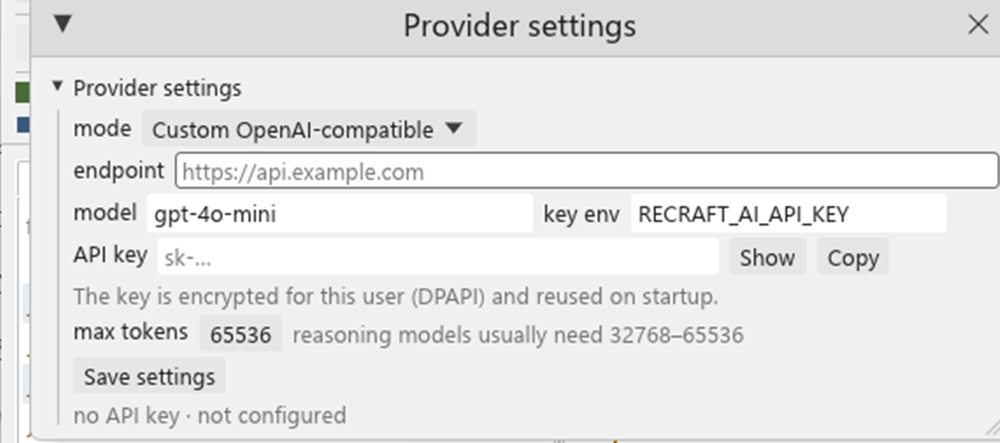

# AI assist（M3）

DESIGN §9 的 AI 层分两半：**确定性的离线能力**（解释证据、命名候选、样本初筛）与
**可插拔 LLM**（解释、命名、润色的最终产出）。离线证据负责“选哪个函数、凭什么”，模型
负责措辞与命名，两条路径共用同一套 `Proposal` 协议与 prompt 层。

核心原则（DESIGN §9.1）：**LLM/启发式只能产生 `Proposal`，禁止静默改库**。Proposal 必须带
证据地址与置信度，用户 review 后经 `Command` 总线（journaled、可 undo）应用。

## 命令

```powershell
# 函数解释：API 标签、引用字符串、直接调用、指令数；--llm 时把脱敏 prompt 交给模型
recraft-cli ai explain notepad.rcraft --addr entry [--json] [--llm]

# 命名建议：只针对 sub_* 函数，输出 Proposal（证据 + 置信度 + 理由），不修改项目；
# --llm 时由模型给出名字（回复按 `0xADDR name -- rationale` 解析）
recraft-cli ai suggest notepad.rcraft [--limit 20] [--json] [--out proposals.json] [--llm]

# 样本摘要：API 分类统计、可疑函数 top-N、URL
recraft-cli ai triage notepad.rcraft [--json]

# 应用已 review 的 proposals（无 --yes 直接拒绝）
recraft-cli ai apply notepad.rcraft proposals.json --yes

# 自然语言查询（DESIGN §9.2）：离线意图解析 → 本地表查询
recraft-cli ai query notepad.rcraft "find every function that references a URL" [--json]
recraft-cli ai query notepad.rcraft "找所有引用字符串 Microsoft 的函数"
recraft-cli ai query notepad.rcraft "which functions call CreateFileW"

# 伪代码润色（DESIGN §9.2）：需要已配置 LLM；只输出建议，不写回项目
recraft-cli ai polish notepad.rcraft --addr entry [--json] [--no-cache]

# 项目级 Agent：模型自己调用只读工具（函数列表/伪代码/xref/字符串/API 调用者）后作答
recraft-cli ai ask notepad.rcraft "哪些函数在操作注册表？" [--json] [--rounds 8]
```

## 自然语言查询（离线）

`ai query` 先在本地识别意图，再查已分析项目的派生表（strings/xref/API tags/functions），
**不联网**：

| 意图 | 触发关键词 | 回答内容 |
|---|---|---|
| `urls` | url/http/网址/链接 | 以 `http(s)://`/`www.` 开头的字符串 + 引用它们的函数 |
| `api_callers` | 调用/引用/call/caller + 句中出现已知 API 名 | 调用该 API 的函数列表 |
| `function_callers` | 同上 + 函数名/引号目标 | 该函数的调用者 |
| `text` | 字符串/string/text 或兜底 | 名字/字符串内容匹配，并附引用函数 |

未识别的目标会抽取句中"最长标识符"（如 `CreateFileW`、`Microsoft`）继续查询，而不是
退化为整句匹配。`--json` 输出 `{intent, query, items:[{kind,addr,text,functions}], count}`。

## 伪代码润色（需 LLM）

`ai polish` 取该函数的 **L1** 输出，构造带脱敏的 prompt（`POLISH_SYSTEM`：只允许改善命名/
格式，禁止改动语义），经 provider 发送；结果仅打印（带 `// AI polish suggestion` 头），
**不写回项目**，并复用结果缓存（prompt 哈希）与审计日志。未配置 provider 时直接报错并
给出配置提示（默认离线）。

## Proposal 协议

```json
{
  "kind": "rename",
  "target": "0x1400012dc",
  "value": "network_1400012dc",
  "confidence": 0.65,
  "rationale": "calls InternetOpenUrlW; 1 string ref(s)",
  "evidence": [
    {"addr": "0x140001368", "kind": "api_tag", "text": "WININET.dll!InternetOpenUrlW"},
    {"addr": "0x140002e7f0", "kind": "string", "text": "http://example/"}
  ]
}
```

- `apply` 把 `rename` / `comment` / `prototype` / `apply_type` 映射为对应 `Command`
  （`Rename`/`SetComment`/`SetPrototype`/`ApplyType`），写入 journal，可 `recraft-cli undo`
  撤销；`apply_type` 的 proposal value 形如 `"0:Probe"`（槽位:结构体名，空类型名=清除）。
  `ai suggest` 本身永不写库。
- 无 `--yes` 时返回 "refusing to apply proposals without --yes"，防止误操作。

## 命名启发式（离线）

对每个 `sub_*` 函数，依据函数内 call 站点的 API 类别与引用字符串选择前缀
（`network` / `memory` / `file` / `process` / `thread` / `registry` / `service` /
`crypto` / `anti_debug` / `inject` / `ui`），并追加函数地址保证唯一；置信度随证据数
增长（0.35 → 0.9 上限）。没有证据的函数不产生建议。

## 样本摘要（triage）

- `apis_by_category`：全样本 API 标签按类别计数。
- `suspicious`：按函数聚合 API 类别加权（injection 4、anti-analysis 3、service 2.5、
  registry/process 2、network/thread 1.5、crypto 1.2、memory/file 1、ui 0.5、other 0.2），
  取 top-10。
- `urls`：字符串表中 `http(s)://` 开头的去重 URL（最多 20）。

## 实现与测试

- 代码：`crates/recraft-ai`（`explain` / `suggest_names` / `triage` / `Proposal` /
  `apply_proposals`）。
- 测试：notepad 真实样本——解释入口函数、建议带证据、`apply` 后 `name_at` 生效且可 undo、
  triage 类别非空、Proposal JSON roundtrip。
- CLI 冒烟纳入 `scripts/e2e.ps1`（triage JSON / suggest --out / apply --yes）。

## UI proposal 面板（M3）

左侧新增 **AI** 页签：

- **Suggest names**：先用本地 `suggest_names` 选出有证据的 `sub_*` 候选（证据地址、置信度、
  回退名字），再把候选的摘要/API/字符串/函数体片段按 rename prompt 交给已启用的 provider；
  模型按 `0xADDR name -- rationale` 逐行回答，解析后替换名字与理由，未命中的候选保留本地
  回退名。**候选按证据权重与调用者数排序**（API×2 + 字符串×3 + 调用者数），不再按地址取
  前 N 个；prompt 在 token 预算 80% 内装批（单次最多 32 个），每个候选带最多 14 行 L2 函数体
  ——只给 API 名与字符串时命名基本靠猜。结果显示为 `置信度 地址 -> 名称` 并标注来源
  （`[模型]` / `[本地]` / `[外部]`），证据链接可跳转到对应地址。请求在后台线程流式执行，
  UI 不阻塞；回复解析不出任何名字时提示并保留本地建议；状态栏报告“模型命名 N/M 个候选”。
- **批量 review 与 apply**：每行有勾选框，另有 **全选 / 清空选择**；**Apply selected (N)**
  把勾选的 proposal 逐条经 `Command` 总线执行（journaled，`Ctrl+Z` 逐条撤销）。中途被拒绝
  （例如重名）时提示“已应用 N 条，随后失败：…”，不会假装整批成功。
- **Explain / Polish 结果锚定函数**：结果区顶部显示结果所属函数（名称 + 地址）并提供跳转；
  光标移到别的函数后显示“光标已移到别的函数”，避免旧答案看起来仍属当前函数。
- **Explain**：把当前光标所在函数的摘要/API 标签/引用字符串/L2 伪代码组成脱敏 prompt，
  交给已启用的 provider 流式解释，结果显示在面板内（prose，不做语法着色）；未配置
  provider 时提示先配置。
- **Query（离线 NL 查询）**：输入 `urls`、`callers of CreateFileW`、`text http` 等自然语言，
  复用 `answer_query` 意图解析；结果显示 kind/地址/文本与相关函数，点击条目反跳反汇编。
- **Polish**：对当前函数构建润色 prompt 并调用已启用的 provider；未启用时提示先配置。
  请求在后台线程执行，UI 不阻塞；结果只做展示（不写回伪代码），并按伪代码语法着色
  （关键字/类型蓝、寄存器紫、符号名金、数字与字符串/注释绿，与 Decompile 视图同一套配色；
  Explain 的说明文本保持纯色）。
- **Re-polish（重新润色）**：润色结果出现后，Polish 旁多出一个「重新润色」按钮。普通
  Polish 会先查本次会话的 `PromptCache`（命中时状态显示“润色完成（使用缓存）”并立即返回
  同一段文本）；重新润色跳过这次查缓存，重新向模型要一版，完成后用新答案覆盖该 prompt
  的缓存。用于对第一条建议不满意、或想换个模型/思考模式重试时。
- **Provider settings**：UI 内直接编辑 provider 类型、endpoint、model、API key 环境变量名与
  max tokens，保存到 `%LOCALAPPDATA%\ReCraft\ai-settings.json`（只存环境变量名，**不存密钥**）。
  保存后从环境变量重算 `enabled`；CLI 的 `ai provider` 仍可查看解析结果。
- **Clear** 清空当前建议、解释与状态。

无项目/未分析时会提示先 Analyze。UI 不会在后台自动应用任何提案。

## Provider 抽象与 prompt 安全（M3 地基）

HTTP 传输已实现（OpenAI-compatible + Ollama；见 `recraft-ai/transport.rs`），CLI 与 UI 共用同一
provider 层：

```powershell
recraft-cli ai provider                      # 解析后的配置（不打印密钥）
recraft-cli ai explain notepad.rcraft --addr entry --llm
recraft-cli ai polish notepad.rcraft --addr entry
recraft-cli ai prompt notepad.rcraft --addr entry [--max-tokens 1024] [--json]
```

- **默认未配置**：`ProviderSettings` 默认 `disabled`（无 endpoint / key）；启用 HTTP provider
  必须同时设置 `RECRAFT_AI_PROVIDER=openai|ollama`、`RECRAFT_AI_ENDPOINT`，且
  `RECRAFT_AI_API_KEY`（变量名可配）非空，否则 `enabled=false`。UI 设置与文件配置同样遵守。
  GUI 的 Explain / Suggest names / Polish 三个动作都要求已启用的 provider；CLI 的
  `ai explain` / `ai suggest` 默认只跑本地证据，加 `--llm` 才发请求。
- **持久化**：`ProviderSettings::save()` 写入 `%LOCALAPPDATA%\ReCraft\ai-settings.json`；
  `load()` 优先读该文件，缺省回退环境变量，并按当前环境重算 `enabled`。
- **配置项**：`RECRAFT_AI_PROVIDER`、`RECRAFT_AI_ENDPOINT`、`RECRAFT_AI_MODEL`、
  `RECRAFT_AI_API_KEY_ENV`、`RECRAFT_AI_MAX_TOKENS`。
- **桌面端内置模式**（AI 面板 → Provider settings）：`DeepSeek`、
  `OpenCode Go`、`Custom OpenAI-compatible`。选内模式会自动填 endpoint 和模型列表；
  `API key` 输入框会**按当前用户加密保存**（Windows DPAPI，写入 `ai-settings.json`
  的 `api_key_sealed`；其他平台用 `plain:` 前缀的 base64 仅作混淆），点 **Save** 后下次
  启动自动加载；旁边的 **Show/Hide** 可查看明文，**Copy** 可复制。环境变量方式仍可用。

  
- **已验证的兼容端点**（都是 OpenAI-compatible，`RECRAFT_AI_PROVIDER=openai`；endpoint
  填 base，不要带 `/v1`）：
  - **DeepSeek 官方**：`RECRAFT_AI_ENDPOINT=https://api.deepseek.com`，
    `RECRAFT_AI_MODEL=deepseek-flash`（或 `deepseek-v4-pro`），key 为 DeepSeek API key。
    旧的 `deepseek-chat` / `deepseek-reasoner` 已于 2026-07-24 下线，不再可用；两个现役
    模型都支持 1M 上下文与 Thinking / Non-Thinking 双模式。V4 默认开启 thinking，而
    thinking 会让首个正文 token 等上约一分钟，所以默认请求显式发送
    `{"thinking":{"type":"disabled"}}` 直出；AI 面板的 **思考模式**
    （`ai_thinking`）开关会改为请求 thinking，并把 `reasoning_content` 流式显示在
    可折叠的“思考过程”区，答案完成后自动折叠。代码层等价开关是
    `PromptRequest::with_thinking()`。
  - **OpenCode Go**：`RECRAFT_AI_ENDPOINT=https://opencode.ai/inference/go/openai`，
    model 例如 `deepseek-v4.1-flash` / `deepseek-v4-pro` / `kimi-k3`；key 是 Console 里
    复制的 Go API key。DeepSeek 模型需要在 Privacy 里把 Regions 设为 `Global`。
    请求会带 `User-Agent: recraft/<version>` 和稳定的 `x-opencode-session` 头。
    推理模型会把大量预算花在 `reasoning_content`：polish 默认上限 **65536** token
    （`RECRAFT_AI_MAX_TOKENS` 可覆盖）；预算不足时会明确报
    "empty completion … raise RECRAFT_AI_MAX_TOKENS"。
  - 其他 OpenAI 兼容网关同理（如 `https://api.openai.com`）。
- **prompt 组装**：`build_polish_prompt` 同时提供 **反汇编（权威控制流）** 与 L2 伪代码，
  并明确要求模型以分支目标为准，不要照抄伪代码的块顺序；当调用形状能唯一确定 CRT 函数时，
  允许把 `sub_XXX` 写成 `fgets`/`strcmp`/`strlen` 等规范名，并要求补齐 `extern` 声明。
  `build_explain_prompt`（函数摘要 +
  API 标签 + 引用字符串 + L2 伪代码）与 `build_rename_prompt`（候选函数的摘要 + API 标签 +
  引用字符串，末尾给出 `0xADDR new_name -- rationale` 的行格式要求），都经过：
  - **脱敏**：URL → `<url>`、IPv4 → `<ip>`、邮箱 → `<email>`（`redact`，保留行结构）；
  - **token 预算**：约 4 字符/token，超限截断并标注 `…[truncated]`；
  - **缓存**：`PromptCache`（prompt hash → response）；**审计**：`AuditLog`
    （provider/函数/prompt tokens/response tokens/cached）。
- 传输层：`Transport` trait；`TcpHttpTransport` 处理**明文 http://**（本地 Ollama
  `http://127.0.0.1:11434`），`UreqTransport`（ureq + rustls）处理 **https://**
  （OpenAI 官方端点、云厂商兼容 API）；`transport_for(url)` 按 scheme 选择。
  `MockTransport` 用于无网络单测。
- Provider：`OllamaProvider`（`POST /api/chat`, `stream:false`）与
  `OpenAiCompatibleProvider`（`POST {endpoint}/v1/chat/completions`，Bearer key 从
  配置的环境变量读取）；`provider_from_settings` 在未配置时返回 `UnavailableProvider`
  （直接报 "no LLM provider configured"，不会假装是模型）。
- 使用：`recraft-cli ai explain notepad.rcraft --addr entry --llm` 会在启用 provider 后把
  脱敏 prompt 发送出去，并打印模型回答（`--json` 含 provider/tokens/response）；
  `ai suggest --llm` 走同一条路，把模型回复解析成带证据的 rename Proposal。

## 结果缓存与审计（M3）

- 路径：`%LOCALAPPDATA%\ReCraft\ai-cache.json`、`%LOCALAPPDATA%\ReCraft\ai-audit.jsonl`
  （无 LOCALAPPDATA 时回退临时目录）。
- **缓存 key** = 模板版本 + provider + model + system/user prompt 的哈希；命中时不再发起网络
  请求（`ai explain --llm` 输出 `cached=yes`）。`--no-cache` 跳过读取但仍写回。
- **审计**：每次 provider 交互追加一行 JSONL：`ts/provider/model/template/function/
  prompt_tokens/response_tokens/cached`；写入失败只告警，不影响回答。
- 回归：`scripts/ai-cache-smoke.ps1` 用本地 mock Ollama 服务验证「首次 miss → 二次 hit →
  审计 2 行」，并已加入 CI；单测覆盖缓存落盘往返、key 组成、审计追加。

## Prompt 模板与评测基座（M3）

- **模板版本**：`PROMPT_TEMPLATE_VERSION = "rc-ai-2026-11-v1"`；`EXPLAIN_SYSTEM` /
  `RENAME_SYSTEM` 是导出的模板常量，改文案需同步 bump 版本与评测期望。`rename-v2` 要求模型
  按 `0xADDR name -- rationale` 逐行回答，`parse_rename_reply` 解析（容忍列表符号、反引号、
  代码围栏、缺省理由，丢弃非法标识符与重名），`apply_rename_reply` 把结果合并回本地
  Proposal（未命中的候选保留回退名，证据地址不变，置信度抬到至少 0.7）。两条函数都有离线
  单测，不需要模型。
- **离线评测**（无需模型/网络）：`crates/recraft-ai/src/eval.rs`
  - `EVAL_VERSION = "prompt-eval-2026-10-v1"`，内置 corpus 用例（`field_probe`、
    `array_probe`、`str_probe`、`float_math`、`branchy`）；
  - 检查点：prompt 必须包含函数证据（API/字符串/伪代码片段）、**不含裸 URL**（脱敏生效）、
    token 估算不超过预算；
  - 运行方式：
    ```powershell
    cargo test -p recraft-ai --test prompt_eval
    recraft-cli ai eval corpus-project.rcraft [--json]     # 5/5 passed，失败时非 0 退出
    ```
- 这只保证 **prompt 输入质量**；模型回答的准确率由下面的命名基准度量。

## 命名准确率基准（2026-11-05）

`ai eval-names` 把命名管线跑在**还带真实符号**的函数上，再按符号给分。候选函数取当前
名称不是 `sub_*`/`loc_*`、且是合法 C 标识符的函数（导出、入口、用户命名）；打分前把每个
候选自己的符号——以及递归调用里的自引用——替换成 `sub_<addr>`，模型看不到要被评分的答案。

```powershell
powershell -NoProfile -ExecutionPolicy Bypass -File corpus\build-naming.ps1
recraft-cli import corpus\build\x64\naming.exe -o naming.rcraft
recraft-cli analyze naming.rcraft

recraft-cli ai eval-names naming.rcraft            # 离线启发式基线（无需 key）
recraft-cli ai eval-names naming.rcraft --llm      # 真实模型路径
recraft-cli ai eval-names naming.rcraft --json     # 逐函数行（truth/proposal/overlap/apis/strings）
recraft-cli ai eval-names naming.rcraft --aliases corpus\naming\aliases.json   # 计入可接受同义名
```

评分（`crates/recraft-ai/src/eval_names.rs`，`NAME_EVAL_VERSION = name-eval-2026-11-v1`）：
先归一化（小写、驼峰拆词、去掉启发式追加的 `_<地址>` 尾巴），`exact` 比较词集合（词序
无关，`probe_field` == `field_probe`），`partial` 为词重叠 ≥ 0.5（Jaccard），`overlap` 为
平均词重叠。**exact 只认真实符号**，这是严格口径；`--aliases` 的清单给每个函数一组
可接受的同义名（`corpus/naming/aliases.json`，人工整理），命中别名计入独立的 **accepted**
指标，不污染 exact。`read_config_file` 对 `open_config_file` 因此是 accepted + partial，
而不是 partial-only。

`corpus/naming/naming.c` 是基准二进制：26 个语义函数，覆盖文件/注册表/网络/加密/服务/
剪贴板/进程快照等真实 Win32 API 与字符串，用 CRT 编译并导出（导出表即 ground truth）。
不用 `corpus/c/functions.c` 做命名基准，是因为它 CRT-free、几乎没有 API/字符串，命名证据
为零，只能测出“没有证据时模型会瞎猜”。

**实测基线（2026-11-05，`deepseek-flash`，27 个带符号函数）**：

| 模式 | exact（真值） | accepted（含别名） | partial | 平均词重叠 |
|---|---|---|---|---|
| 离线启发式 | 0/27 | 0/27 | 3/27（11.1%） | 0.13 |
| 模型 | 0–1/27 | 4/27（14.8%） | 18/27（66.7%） | 0.52 |

模型输出有随机性（同一 prompt 两次运行可能是 `read_config_file` 或 `open_config_file`），
exact 一列标成区间；accepted/partial 才是稳定的判断口径。逐条看：`read_config_file`、
`get_temp_path`、`generate_random_bytes`、`delete_old_registry_key` 完全是人会接受的名字，
`check_single_instance_mutex`、`install_and_start_service`、`append_log_started` 只多了修饰词；
剩下的 0 分集中在**没有 API/字符串证据**的函数（`base64_encoded_length`、`compute_crc32`、
`compare_version_strings`、`start`）——`suggest_names` 本来就不会把这类函数交给模型，
所以真实候选集上的质量高于全表。

结论与用法：**有证据的函数值得一用**，**没有证据的函数不要交给模型**；改 prompt/候选排序后
重跑这三行，数字下降即回退。

顺带修掉了一个证据缺口：函数扫描把 `call qword ptr [IAT]` 当成死路，导致每个函数在第一个
导入 API 调用处就停止，后面的调用、块和 API 标签全部丢失（notepad 448 个标签）。改为继续
扫描后 notepad 有 **1 637** 个标签，命名/解释/初筛的证据才够用；同时发现 4 个此前不可达的
函数（502 → 506）。

## 项目级 Agent（工具调用）

一次性按钮回答不了“这个样本的持久化在哪”“谁解析命令行”这类问题——它们需要模型自己决定
看哪个函数、看多少。`ai ask` 与面板里的 **分析助手** 把项目暴露成 8 个只读工具，让模型在
最多 `AGENT_MAX_ROUNDS=8` 轮内自己取证：

| 工具 | 作用 |
|---|---|
| `list_functions` | 按名字子串列函数（地址/大小），先找候选 |
| `function_info` | 名字、范围、指令数、API 标签、引用字符串、直接调用与调用者（复用 `explain`） |
| `pseudocode` | 读该函数的 L2 伪 C（默认 150 行、上限 400 行） |
| `xrefs_to` / `xrefs_from` | 谁引用它 / 它引用谁（附所属函数名） |
| `find_api_callers` | 哪些函数调用某个导入 API（如 `CreateFileW`） |
| `search_strings` | 按内容搜字符串表 |
| `disassemble` | 原始反汇编（最多 60 条） |

- **只读**：工具只查库与反编译，不写项目；重命名仍然走 Proposal/apply。模型给出的重命名
  只是正文建议。
- **有界**：轮数上限、每次结果都截断（列表/行数/字符串长度），未知工具或坏参数以
  `{"error": …}` 返回给模型让它可以自我纠正；预算用尽时会收回工具并要求“用已有证据作答”。
- **多轮追问**：面板保留整段对话（系统提示只出现一次，答案也写回历史），下一个问题可以
  直接接着问“那它的调用者呢”；**新对话**按钮清空上下文。CLI 的 `ai ask` 是一次性问答。
- 桌面端在**工作线程**里打开第二个 SQLite 连接跑整个循环，UI 只接收工具调用轨迹与最终答案；
  工具轨迹显示在「工具调用 · N」折叠区，用来核对答案的证据。答案里引用的 `0x…` 地址会被
  提取成可点链接（只保留落在已知函数内、去重后最多 10 个），点一下即跳转反汇编。
- 当前**不做流式输出**：工具轮次之间没有可流的内容，最终答案一次性到达。

实测（naming 基准样本）：问“哪些函数在操作注册表”，模型依次调用
`find_api_callers("Reg")` → `search_strings("Software\\")` → 三个 `function_info`/`pseudocode`
→ `xrefs_to`，给出三个注册表函数的逐条分析，并额外发现 `read_registry_string` 调用了反调试桩、
以及 `delete_registry_tree` 只删子键不递归。这类结论单看一个函数的伪代码得不到。

## 限制与后续

- **评分的同义词问题**：`exact` 只认真实符号；`--aliases corpus/naming/aliases.json` 的
  人工别名集给出 accepted 指标（4/27），但别名由人工整理，换一个样本需要重新整理；模型
  输出有随机性，单次运行的数字应结合 accepted/partial 看，不要只盯 exact。
- **单条 diff 预览**：批量 apply 已支持，但 apply 前没有 before/after 名称对比视图。
- **网络可达性**：开发环境仅放行部分域名；TLS 栈通过 `https://crates.io/` 的忽略测试
  （`cargo test -p recraft-ai https_tls_handshake_to_crates_io -- --ignored`）验证，
  `api.openai.com` 在本环境不可达，未做端到端 OpenAI 账号测试。
- **命名质量取决于模型**：GUI 的 Suggest names 与 `ai suggest --llm` 都让模型基于证据起名，
  仍可能给出与语义不符的名字，apply 前需要人工 review；离线回退名仍是「类别前缀 + 地址」，
  面板用 `[本地]` 标注，不要当成模型建议。
- 写工具仅 `rename`/`comment`；`set_prototype` / `define_function` / `apply_type` 尚未实现。
