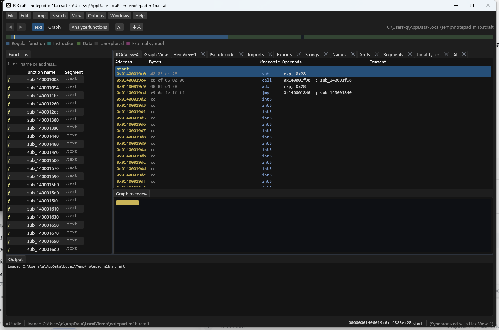
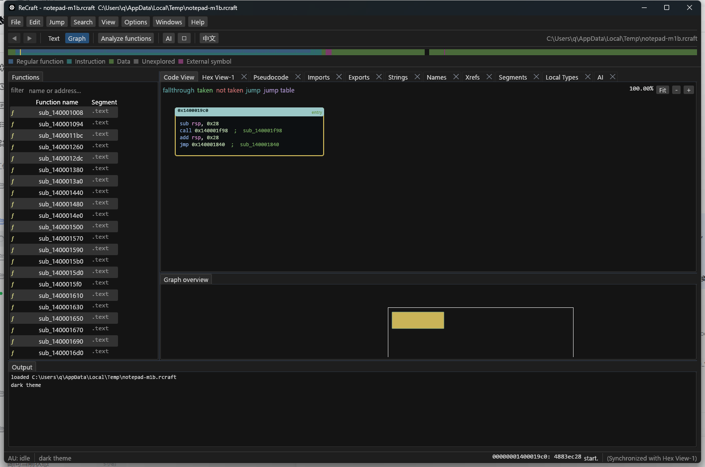
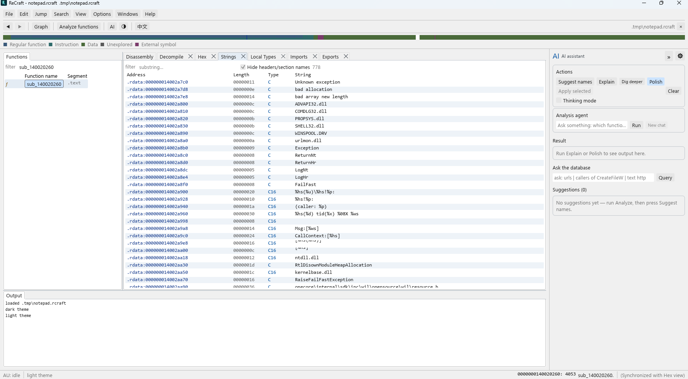
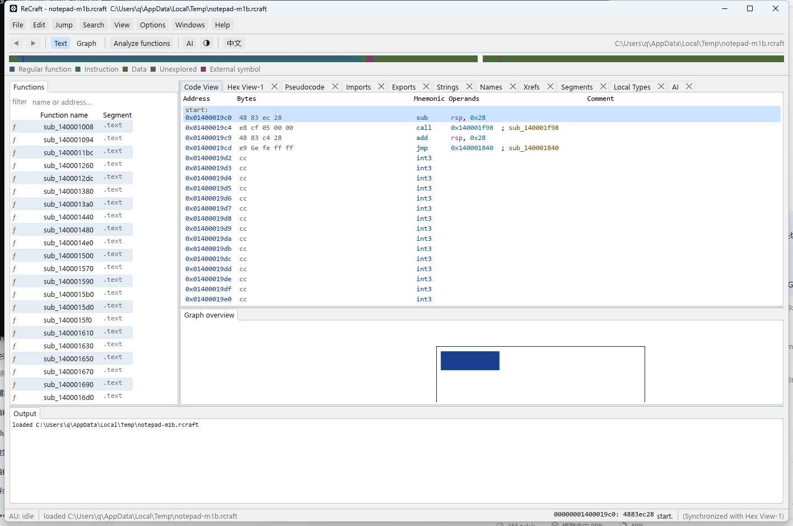
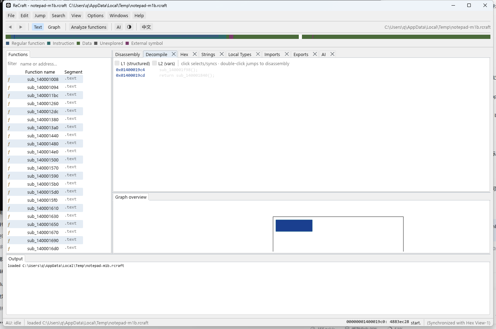

# 10 分钟演示（DESIGN M4）

一条命令跑完 CLI 全流程；随后给出 GUI 走查脚本与对外演示话术。

## 前置条件

- Windows 10/11 x64；VS2022（仅构建 corpus 需要）、Rust 1.85+。
- `cargo build -p recraft-cli -p recraft-ui`；corpus 已构建（`corpus/build/x64/corpus.exe`，
  没有则演示脚本自动回退到 `notepad.exe`）。
- 演示脚本不会改动仓库：项目建在 `%TEMP%\recraft-demo-*`，结束时删除（`-Keep` 保留）。

## 一键演示

```powershell
pwsh -File scripts/demo.ps1            # corpus 存在则用它，否则 notepad
pwsh -File scripts/demo.ps1 -Keep      # 保留项目，接着开 GUI
pwsh -File scripts/demo.ps1 -PEFile C:\Windows\System32\notepad.exe
```

脚本依次展示（每步打印实际命令与输出，最后 `DEMO PASS`）：

| 步骤 | 展示点 |
|---|---|
| 1 PE headers | 架构、镜像基址、节表（`recraft info`） |
| 2 import + analysis | 导入 → 函数/字符串/xref/API 标签，分析耗时 |
| 3 function discovery | 函数列表（corpus 28 个） |
| 4 structured pseudocode | `decompile --l2`：签名、参数名、结构（if/while） |
| 5 rename + prototype | 命令总线写入，`// prototype:` 与解析后的签名/参数名 |
| 6 struct layout + apply_type | `define-struct`/`apply-type` 后 `arg1->value` |
| 7 AI assist | 真实样本（notepad）上 triage、suggest 生成 Proposal、apply（journal），undo |
| 8 MCP | stdio JSON-RPC：`initialize` + `list_functions` 资源返回 |
| 9 metrics | 覆盖率/结构化成功率门禁指标 |

示例片段（corpus）：

```c
// prototype: int __stdcall demo_entry(const char* text, int count)
// L2 params: text=rcx, count=rdx
int32 __stdcall demo_entry(char* text, int32 count) {
    ...
}
```

AI 片段：

```text
0.65  0x01400012dc -> interesting_1400012dc
      calls api-ms-win-eventing-provider-l1-1-0.dll!EventWriteTransfer; 1 string ref(s)
      evidence 0x0140001368 api_tag: ...
$ recraft ai apply ... --yes
applied 3 proposal(s) through the command bus (undoable)
```

## GUI 走查（1–2 分钟）

1. 启动 `recraft-ui.exe`，**File → Open/Import** 选择 `%TEMP%\recraft-demo-*\demo.rcraft`
   （用 `-Keep` 运行演示脚本会打印路径）。
2. `F5` 运行分析（后台线程，可取消）。工作区按 IDA 布局组织：顶部**菜单栏**（File/Edit/Jump/
   Search/View/Options/Windows/Help）+ **工具栏**（后退/前进、Text/Graph、Analyze、AI、语言、
   项目路径）+ **全局导航带与图例**；左侧 **Functions**（Function name / Segment 两列，带函数
   图标）及其下方 **Graph overview**；右侧**文档标签区**按固定顺序显示 **Disassembly、
   Decompile、Hex、Strings、Local Types、Imports、Exports、AI**（Names、Xrefs、Segments
   默认隐藏，可从 **Views** 菜单打开）；底部 **Output** 窗口；最下方为 **AU/状态栏**（地址、
   字节、函数、与 Hex 同步提示）。
   **Disassembly 是单个视图**，内部有 **Graph / Text 两种模式**：工具栏 `Graph`/`Text` 或
   **空格键**切换，不会切换标签页；Graph 中双击基本块会切到 Text 并定位。图形支持节点块/
   箭头连线与 `Fit`/`-`/`+` 缩放（50–200%）。
   **Options → Theme** 或工具栏 `◐/◑`、`Ctrl+T` 可在**全浅色/全深色**主题间切换；默认是**全浅色**，
   选择随布局一起保存。
   
   
   布局可拖动分屏/合并，自动保存到 `%LOCALAPPDATA%\ReCraft\layout.json`，Views 菜单可聚焦
   pane 或 Reset layout。快捷键：`F2` Functions、`F3` Names、`F4` Strings、`F6` Imports、
   `F7` Xrefs、`F8` Segments、`F9` Hex、`F10` AI、`F11` Local Types；`Space` 切换
   Disassembly 的 Graph/Text；**`Ctrl+=` / `Ctrl+-` / `Ctrl+0`** 缩放/重置代码视图字号
   （Text/Decompile/Hex）。
   **Strings** 采用 IDA 风格四列：**Address（段:地址）/ Length（hex）/ Type（C/C16）/
   String**；按数据库编码解码（UTF-16LE 不再乱码）、不再截断到 64 字节；单击选中并同步
   反汇编光标、双击跳到反汇编；可勾选隐藏 header/节名噪声，过滤框保留。双击字符串会
   在 Disassembly 中以数据行显示（`db '…',0` 或 `dw`，带 `; DATA XREF`），而不是把
   字节当指令反汇编。
   
   **Text 模式**操作数按语义分色：寄存器紫、立即数/地址青、符号名棕、字符串绿。
   
   注：拖出的 tab 目前是**应用内浮动窗口**，不是独立 OS 窗口（评估与后续计划见
   [ADR-012](adr/ADR-012-multi-window.md)）。
3. 点击函数 → 中间 **Decompile** 页签，直接显示结构化反编译与签名（没有 L0/L1/L2 开关）；**Disassembly**
   的 **Graph** 模式看 CFG。
   反编译与反汇编**联动**：反汇编行有 IDA 式整行高亮（点击任意位置选中、双击跟随、右键菜单、
   工具栏 ◀ ▶ 前进后退、顶部导航带可点击跳转）；反汇编选中行在反编译里同步高亮，
   反编译**单击**同步光标；**双击函数名进入该函数**（`Back`/◀ 返回调用方），**双击字符串字面量跳到该字符串的数据**（`db '…',0`），双击其他位置跳到反汇编。
   
4. 底部 **Hex** 面板跟随选中地址（可切 Bytes/Words、点击选字节、双击跳转、Follow
   selection 回到当前函数）；**Enter/双击地址**跟随操作数目标，`Esc` 回退。
   **数据/类型操作**：反汇编行按 `C`（代码）/`D`（数据）/`A`（字符串数据）/`U`（取消定义）/
   `P`（建函数），或右键菜单选择；**右键 → Structures…** 打开结构体窗口，可定义
   `0:tag:u32, 16:value:i32` 布局并绑定到当前函数参数槽；右键 **Edit prototype…** 编辑函数原型。
   左侧 **Functions** 有过滤框（名字/地址）；**Decompile** 行点击反跳反汇编；**Xrefs**
   显示引用类型，双击直接跟随到反汇编。
5. 左侧 **AI** 页签 → **Suggest names**：列出 `置信度 地址 → 名称` 与证据地址；
   选中一条 → **Apply selected**（journaled，`Ctrl+Z` 撤销），证据链接可跳转。
   **Query** 可输入 `urls` / `callers of CreateFileW` / `text http` 做离线检索（点击结果跳转）；
   **Explain** 离线解释当前函数；**Provider settings** 可配 endpoint/model/密钥环境变量
   （保存在 `%LOCALAPPDATA%\ReCraft\ai-settings.json`），启用后 **Polish** 在后台线程润色。
6. **Strings/Xrefs/Imports** 页签展示引用与 API 分类；UI 支持 EN/zh-CN 切换。

## 对接 MCP 客户端

```json
{
  "mcpServers": {
    "recraft": {
      "command": "C:\\path\\to\\recraft.exe",
      "args": ["serve-mcp", "C:\\path\\to\\project.rcraft"]
    }
  }
}
```

客户端可获得 `list_functions`、`get_disassembly`、`get_pseudocode`、`xrefs_*`、
`list_strings`、`list_imports`、`callgraph`、`search_bytes`、`function_summary`，
以及 `recraft://project/{id}/functions|strings|imports|pseudocode/{func}` 资源。

## 本地 LLM（可选）

```powershell
# 本机 Ollama（默认离线，显式开启才联网）
$env:RECRAFT_AI_PROVIDER = 'ollama'
$env:RECRAFT_AI_ENDPOINT = 'http://127.0.0.1:11434'
$env:RECRAFT_AI_MODEL = 'qwen2.5-coder'
$env:RECRAFT_AI_API_KEY = 'local'      # Ollama 不校验，但启用条件要求存在
recraft ai provider                     # state=enabled
recraft ai prompt demo.rcraft --addr entry   # 发送前 review 脱敏 prompt
recraft ai explain demo.rcraft --addr entry --llm
```

## 演示话术（对外 10 分钟）

1. **问题**（1 min）：闭源 IDA 昂贵/不可定制；ReCraft 是 AGPL + 商业双许可的原生 Rust 工具。
2. **导入与分析**（2 min）：1 GiB 样本门禁（zip 体积、内存 ≤512 MiB）、函数发现、API 分类。
3. **反编译**（3 min）：L2 结构化、字段/数组/结构体/原型、golden 回归与质量门禁。
4. **AI 与写回**（2 min）：Proposal 带证据与置信度；只有人工确认才经命令总线写入，可 undo。
5. **生态**（1 min）：MCP 让 Claude/Cursor 等直接查询项目；纯本地、无云端依赖。
6. **路线**（1 min）：M3 打包/预览 → 动态调试（后续版本）。

## 排障

- `demo assertion failed`：通常是 corpus 未构建或不是 x64；重建 `corpus/build.ps1`。
- 中文乱码：用 Windows Terminal / PowerShell 7；本仓库脚本为 ASCII 输出。
- AI 无建议：样本没有 API 导入/字符串引用时启发式不会提案（corpus 就是这种情形），
  演示脚本因此自动改用 notepad 演示 AI。
